В ЕГЭ-2023 по информатике появилась новая задача под номером 6, про  Черепашку. Эта задача проверяет наше умение анализировать алгоритмы  управления исполнителями и вычислительные алгоритмы на простейшем  уровне.

Важно помнить, что задача №6 действительно простая. Наша цель —  получить верный ответ, не усложняя процесс. Нет необходимости писать  универсальную программу, способную считать количество точек для любой  возможной траектории. Мы решаем задачу для конкретной предложенной  ситуации, следуя логике и простым вычислениям.

Для успешного решения этой задачи нам не нужно знать каких-то сложных теоретических терминов, потому что задание направлено на практику.  Единственное определение, которое нам важно понимать – это алгоритм.

**Алгоритм** — это точная и конечная последовательность  шагов или инструкций, которые необходимо выполнить, чтобы достичь  определённой цели или решить задачу. Каждый шаг алгоритма однозначно  определён, что позволяет достичь нужного результата, если выполнять  инструкции последовательно.

В контексте задачи с Черепашкой алгоритм — это список команд, таких  как «Вперёд», «Направо», «Поднять хвост», которые указывают, что именно  должна делать Черепашка. Выполняя алгоритм, Черепашка последовательно  исполняет каждую команду, следуя заданным инструкциям, и, таким образом, рисует фигуру или достигает конкретного положения на плоскости.

Также давайте разберёмся, что такое пересечение и объединение:

**Пересечение фигур** — это область, которая общая для  двух или более фигур. Если черепашка, выполняя свои команды, проходит  несколько раз через одну и ту же часть плоскости, то точки в этой  области будут относиться к пересечению её траекторий. В задачах с  черепашкой, когда говорится о пересечении, нужно учитывать только те  точки, которые находятся внутри всех фигур, образованных траекториями, и не включать уникальные части каждой из фигур.

Пример: если черепашка рисует два пересекающихся квадрата, то область пересечения — это часть плоскости, которая покрыта обоими квадратами.

**Объединение фигур** — это совокупность всех областей,  покрытых одной или несколькими фигурами. В объединение включаются все  точки, которые попадают под какую-либо фигуру, независимо от того,  перекрываются ли они другими фигурами или нет. Это значит, что при  подсчёте точек в объединении не нужно дважды учитывать одну и ту же  область, даже если она попадает под несколько траекторий черепашки.

Пример: если черепашка рисует два пересекающихся квадрата, то  объединение — это площадь обоих квадратов, включая их перекрывающиеся  части (их учитывают только один раз).

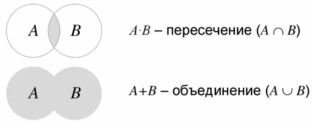

Перейдём к **примеру решения** прототипов задач:

Разберём задачу **№6 ЕГЭ 2025 из демоверсии ФИПИ:**

*Исполнитель Черепаха действует на плоскости с декартовой системой координат. В начальный момент Черепаха находится в начале координат, её голова направлена вдоль положительного направления оси ординат, хвост  опущен. При опущенном хвосте Черепаха оставляет на поле след в виде  линии. В каждый конкретный момент известно положение исполнителя и  направление его движения. У исполнителя существует 6 команд: **Поднять хвост**, означающая переход к перемещению без рисования; **Опустить хвост**, означающая переход в режим рисования; **Вперёд n** (где n — целое число), вызывающая передвижение Черепахи на n единиц в том направлении, куда указывает её голова; **Назад n** (где n — целое число), вызывающая передвижение в противоположном голове направлении; **Направо m** (где m — целое число), вызывающая изменение направления движения на m  градусов по часовой стрелке; Налево m (где m — целое число), вызывающая  изменение направления движения на m градусов против часовой стрелки.*

*Запись **Повтори k [Команда1 Команда2 … КомандаS]** означает, что последовательность из S команд повторится k раз.*

*Черепахе был дан для исполнения следующий алгоритм:*

***Повтори 9 [Вперёд 22 Направо 90 Вперёд 6 Направо 90]\***
***Поднять хвост\***
***Вперёд 1 Направо 90 Вперёд 5 Налево 90\***
***Опустить хвост\***
***Повтори 9 [Вперёд 53 Направо 90 Вперёд 75 Направо 90]\***

*Определите периметр области пересечения фигур, ограниченных заданными алгоритмом линиями.*

**Решим задачу, используя среду Кумир и аналитику:**

1. Открываем нашу программу Кумир, импортируем исполнителя «Черепаха» (использовать Черепаха), переписываем наш алгоритм, соблюдая синтаксис  нашего языка:

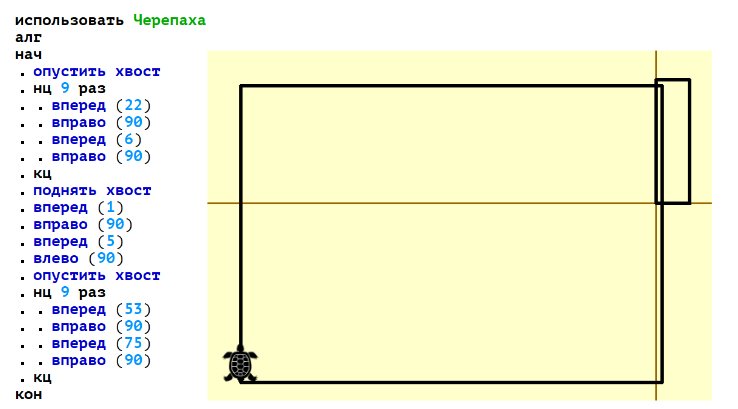

2. Мы получили результат нашего алгоритма, но **очень важный момент**: когда мы приближаем наш чертёж, количество клеточек меняется. Почему?  Всё дело в том, что сейчас мы используем автоматическое масштабирование. Чтобы его убрать, нажимаем на 3 полоски, убираем галочку «авто» и в  строке «сетка» устанавливаем 1:

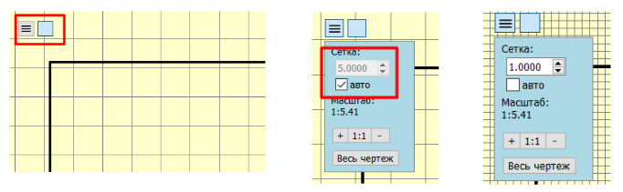

3. Вспоминаем условия нашей задачи: нам нужно посчитать периметр области, которая получилась в результате пересечения фигур:

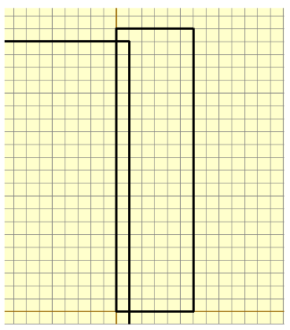

4. Чтобы нам точно не ошибиться в подсчёте количества клеток (для  того, чтобы посчитать периметр), мы можем сделать скриншот и аккуратно  посчитать в paint, используя кисть: получаем 21 клетку внутри, то есть  периметр равен 21 * 2 + 2 = 44

**Ответ:** 44

 

**Дальше посмотрим задание из варианта с основной волны 08.06.2024:**

**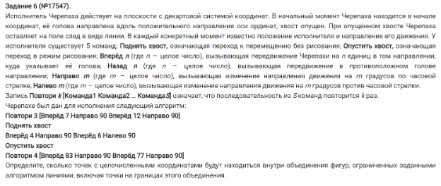**

*Исполнитель Черепаха действует на плоскости с декартовой системой координат. В начальный момент Черепаха находится в начале координат, её голова направлена вдоль положительного направления оси ординат, хвост  опущен. При опущенном хвосте Черепаха оставляет на поле след в виде  линии. В каждый конкретный момент известно положение исполнителя и  направление его движения. У исполнителя существует 6 команд: **Поднять хвост**, означающая переход к перемещению без рисования; **Опустить хвост**, означающая переход в режим рисования; **Вперёд n** (где n — целое число), вызывающая передвижение Черепахи на n единиц в том направлении, куда указывает её голова; **Назад n** (где n — целое число), вызывающая передвижение в противоположном голове направлении; **Направо m** (где m — целое число), вызывающая изменение направления движения на m градусов по часовой стрелке; **Налево m** (где m — целое число), вызывающая изменение направления движения на m градусов против часовой стрелки.*

*Запись **Повтори k [Команда1 Команда2 … КомандаS]** означает, что последовательность из S команд повторится k раз.*

*Черепахе был дан для исполнения следующий алгоритм:*

**Повтори 3 [Вперёд 7 Направо 90 Вперёд 12 Направо 90]**
**Поднять хвост**
**Вперёд 4 Направо 90 Вперёд 6 Налево 90**
**Опустить хвост**
**Повтори 4 [Вперёд 83 Направо 90 Вперёд 77 Направо 90]**

*Определите, сколько точек с целочисленными координатами будут  находиться внутри объединения фигур, ограниченных заданными алгоритмом  линиями, включая точки на границах этого объединения*.

**Представим, что вы пришли на экзамен и почему-то не увидели  на своём компьютере Кумир, что же делать? Давайте разберём решение с  помощью программирования на python:**

1. Импортируем модуль «turtle» (аналог исполнителя Черепашки на  кумире), переписываем наш алгоритм, используя синтаксис языка и нашей  библиотеки (fd – forward (вперёд), bk – back (назад), rt – right  (вправо), lt – left (влево), up – поднять хвост, down - опустить). **Важно:** изначально по условию Черепаха должна смотреть вверх, а по умолчанию в  нашей программе она смотрит вправо, поэтому ей нужно развернуть на 90°  влево. Сразу же для увеличения масштаба нашего чертежа введём переменную m, на которую умножаем шаги назад и вперёд (то есть те, шаги, в которых черепаха движется, а не вращается):

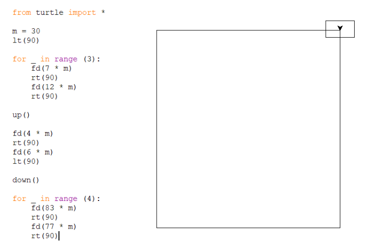

2. Теперь нам нужно проставить точки, которые мы и будем считать:  поднимаем хвост, чтобы во время отрисовки точек Черепаха не рисовала  линию за собой и пишем вложенный цикл, диапазон по **x** и по **y** можем поперебирать, чтобы он полностью покрывал наш чертёж. Чтобы долго не ждать, пока Черепаха нарисует фигуру и точки, отключаем анимацию  (tracer(0)):

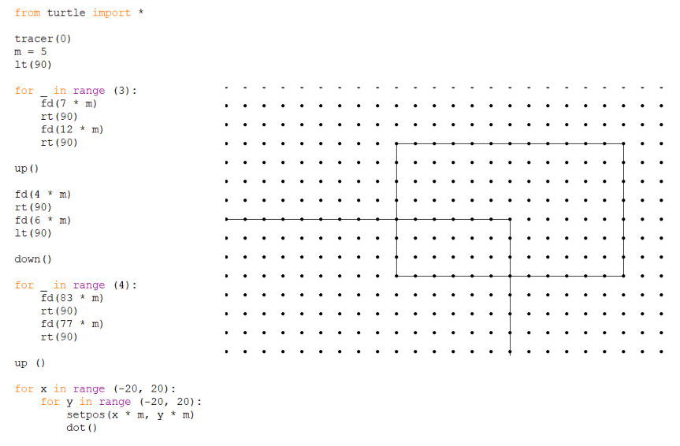

3. Если вдруг наш чертёж не помещается на экране, можно в начале  нашей программы прописать screensize (2000, 2000) – такого размера  экрана вам точно хватит в большинстве задач. Ещё момент: в аргументе у  dot() можно указать её размер, а вторым аргументом и цвет, но нам  подойдёт и стандартный.
4. Как мы видим, фигура у нас получилась большая, поэтому чтобы  посчитать количество точек в объединении, нужно посмотреть в наш  алгоритм: в первом цикле мы рисуем маленький прямоугольник, считаем,  сколько входит точек в него: 13 * 8 = 104 (точек на одну больше, чем  шагов сделала Черепаха). Во втором цикле мы рисуем большой  прямоугольник, его площадь равно 84 * 78 = 6552,
5. Но, если мы просто сложим эти числа, мы найдем неверный ответ.  Почему? Всё дело в том, что мы дважды посчитаем пересечение наших  прямоугольников, поэтому его нужно вычесть из нашей итоговой суммы  (количество точек в пересечении 4 * 7 = 28)
6. Считаем ответ: 6552 + 104 – 28 = 6628

**Ответ:** 6628

 

**Дальше посмотрим досрочную волну 2024 года:**

*Исполнитель Черепаха действует на плоскости с декартовой системой координат. В начальный момент Черепаха находится в начале координат, её голова направлена вдоль положительного направления оси ординат, хвост  опущен. При опущенном хвосте Черепаха оставляет на поле след в виде  линии. В каждый конкретный момент известно положение исполнителя и  направление его движения. У исполнителя существует 6 команд: **Поднять хвост**, означающая переход к перемещению без рисования; **Опустить хвост**, означающая переход в режим рисования; **Вперёд n** (где n — целое число), вызывающая передвижение Черепахи на n единиц в том направлении, куда указывает её голова; **Назад n** (где n — целое число), вызывающая передвижение в противоположном голове направлении; **Направо m** (где m — целое число), вызывающая изменение направления движения на m градусов по часовой стрелке; **Налево m** (где m — целое число), вызывающая изменение направления движения на m градусов против часовой стрелки.*

*Запись **Повтори k [Команда1 Команда2 … КомандаS]** означает, что последовательность из S команд повторится k раз.*

*Черепахе был дан для исполнения следующий алгоритм:*

**Повтори 2 [Вперёд 13 Направо 90 Вперёд 18 Направо 90]**
**Поднять хвост**
**Вперёд 5 Направо 90 Вперёд 9 Налево 90**
**Опустить хвост**
**Повтори 2 [Вперёд 11 Направо 90 Вперёд 7 Направо 90]**

*Определите, сколько точек с целочисленными координатами будут  находиться внутри пересечения фигур, ограниченных заданными алгоритмом  линиями, включая точки на линиях.*

**Решим с помощью Кумира:**

1. Переписываем наш алгоритм, не забываем про масштаб:

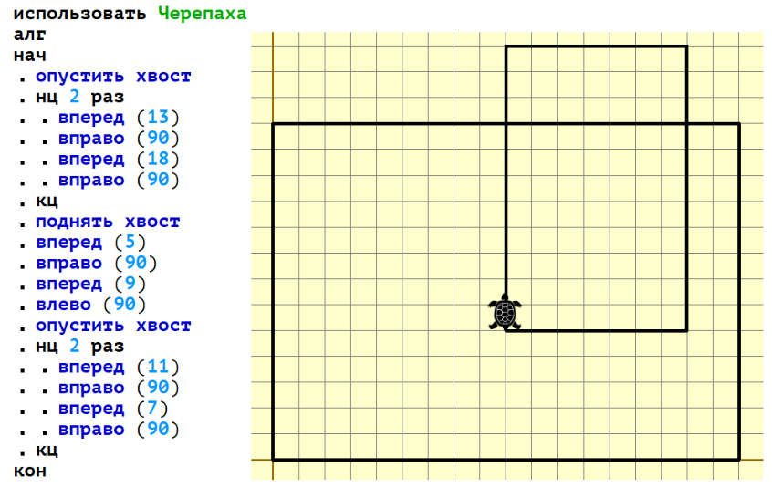

2. Делаем скриншот, идём в paint, аккуратно считаем наши точки  (внимательно смотрим, что от нас хотят в условии: объединение или  пересечение; нужно ли считать точки на линии): 9 * 8 = 72

**Ответ:** 72

 

**Проанализируем следующий прототип задачи:**

*Исполнитель Черепаха действует на плоскости с декартовой системой координат. В начальный момент Черепаха находится в начале координат, её голова направлена вдоль положительного направления оси ординат, хвост  опущен. При опущенном хвосте Черепаха оставляет на поле след в виде  линии. В каждый конкретный момент известно положение исполнителя и  направление его движения. У исполнителя существует две команды: **Вперёд n** (где n  — целое число), вызывающая передвижение Черепахи на n единиц в том направлении, куда указывает её голова, и **Направо m** (где m  — целое число), вызывающая изменение направления движения на m градусов по часовой стрелке. Запись **Повтори k [Команда1 Команда2 … КомандаS]** означает, что последовательность из S команд повторится k раз. Черепахе был дан для исполнения следующий алгоритм: **Повтори 11 [Вперёд 36 Направо 72]** Определите расстояние между положениями Черепахи в начале и в конце  выполнения этой программы. В ответе запишите целое число, ближайшее к  найденному расстоянию.*

Способ 1: аналитический

1. Черепашка получает команду двигаться вперёд на 36 шагов, затем  поворачивать направо на 72 градуса. Эта последовательность повторяется  11 раз. Мы понимаем, что каждый раз после движения вперёд на 36 шагов и  поворота направо на 72 градуса черепашка отклоняется на определённый  угол. Внутренний угол между её траекториями равен 180° − 72° = 108°

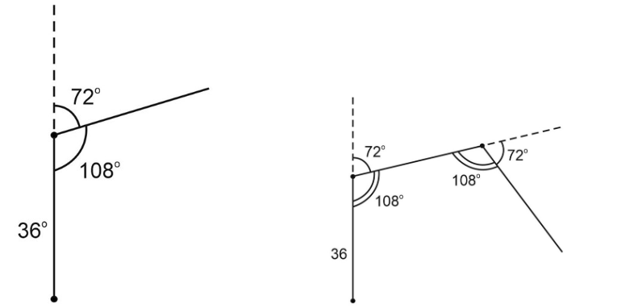

2. Мы понимаем, что черепаха рисует какой-то n-угольник. У вас может не быть транспортира, чтобы точно построить n-угольник, но мы помним  формулу угла в правильном n-угольнике и можем сказать, сколько в нем  углов. Если мы не помним формулу, то для данного конкретного примера  сейчас получим ответ. Проведем прямые от углов n-угольника в центр. В  полученном равнобедренном треугольнике углы при основании будут по 108° : 2 = 54°, а угол в вершине треугольника 180° - 108° = 72°.

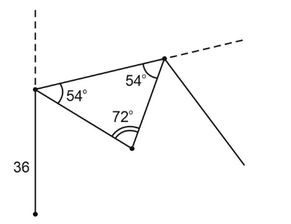

3. Таких уголочков по 72° должно быть n штук. Тогда получится  замкнутая фигура, правильный n-угольник.Делаем вывод, что это будет 5-ти угольник. Поскольку n * 72° = 360°, значит n = 5.

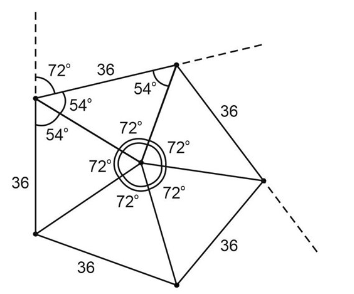

4. Получается, что после пяти итераций черепашка вернулась в исходную точку А. Еще 5 итераций - и опять черепашка в исходной точке А. Всего у нас 11 итераций, значит, она закончила движение в точке В. Между  точками А и В 36 шагов – это и есть ответ задачи.

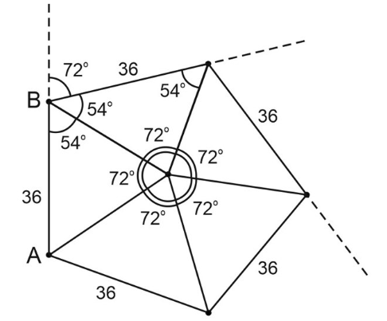

**Ответ:** 36

**Способ 2: программирование**

1. Не забываем, что задача №6 относится к области алгоритмики, а не  программирования. Конечно, можно решить её и с помощью кода. Давайте  попробуем запрограммировать «черепашку» и автоматизировать её движения.  Для этого в Python существует удобный модуль turtle (или «Черепашья  графика»), который позволяет черепашке передвигаться по экрану и  оставлять след, рисуя нужные фигуры. Вот как может выглядеть такая  программа:

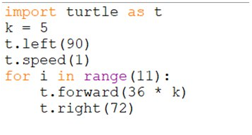

2. Подключаем библиотеку, которая позволяет черепашке двигаться и  рисовать на экране. В задаче сказано «36 вперёд», что означает 36 шагов. Размер одного шага мы можем выбрать сами. Если взять единичный шаг по  умолчанию, рисунок получится слишком маленьким и трудноразличимым.  Поэтому установим шаг равным 5, чтобы чётко видеть, что черепашка рисует на экране.
3. Теперь читаем задание. По условию, исполнитель (черепашка)  изначально смотрит вдоль оси x, то есть вправо. Однако, в нашем  представлении движение «вперёд» обычно означает движение вверх на  экране. Поэтому первым шагом повернём черепашку на 90°, чтобы она  смотрела вверх, а не вправо. Также установим скорость от 1 до 10, где  «1» — самая медленная скорость. Эти параметры не обязательны, но они  помогут нам лучше наблюдать за движением черепашки. Теперь напишем  алгоритм в соответствии с условиями задачи и запустим программу, чтобы  посмотреть, что черепашка будет рисовать на экране.

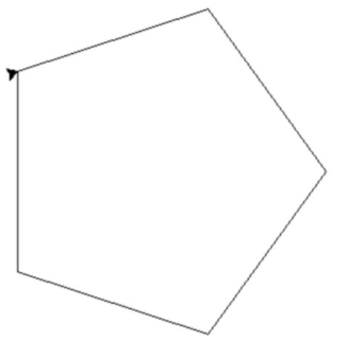

4. Черепаха рисует пятиугольник, который мы вычислили аналитически.  Между начальной и конечной точкой ее движения36 шагов.Получается, что мы поручили черепахе «поползать» и «отрисовать» след.

**Ответ:** 36

 

**Разберём ещё один прототип:**

*Черепахе был дан для исполнения следующий алгоритм: **Повтори 7 [Вперёд 10 Направо 120].** Определите, сколько точек с целочисленными координатами будут  находиться внутри области, ограниченной линией, заданной данным  алгоритмом. Точки на линии учитывать не следует.*

**Решим аналитическим способом (с написанием небольшой программы для перебора):**

1. Эта задача немного сложнее. Нам нужно определить количество точек с целочисленными координатами, которые окажутся строго внутри  нарисованной фигуры, не включая её границу. Черепашка прошла вперёд 10  шагов и повернула на 120 градусов. Поворот на 120° означает, что  внутренний угол составит 60°. Черепашка снова прошла 10 шагов, затем  опять повернула на 120°, создавая тот же внутренний угол в 60°. Этот  цикл повторяется 7 раз. Какую фигуру нарисовала черепашка? Это  равносторонний треугольник со стороной 10.

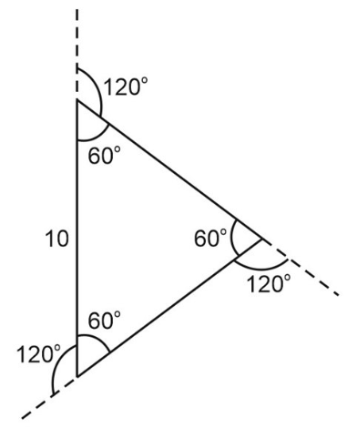

2. Как посчитать целые точки? Вручную это сделать сложно, поэтому мы решим задачу при помощи компьютерной программы. Давайте пока обозначим  формально, что это за область. Если нарисовать систему координат, ось x и ось y, тогда можно записать для этого множества точек систему  неравенств.

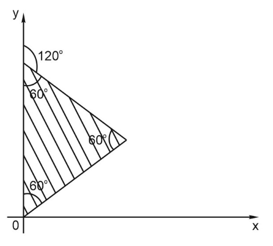

3. Опишем уравнениями три прямые, которые создают заштрихованную плоскость.
4. Это множество точек, которое лежит правее 0, т.е. x > 0
5. Эти точки лежат под графиком убывающей линейной функции, то есть под прямой $y < -\frac{x}{\sqrt3} + 10$
6. Точки лежат выше возрастающей линейной функции, то есть выше прямой $y>\frac{x}{\sqrt3}$

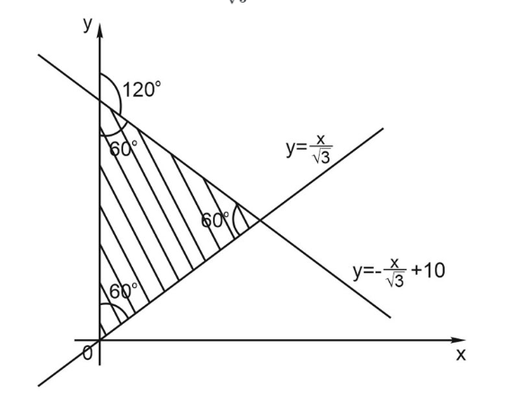

4. Такая система неравенств однозначно задает эту область:

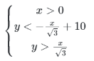

5. Дальше можно перебирать все значения **x** и **y** в каком-нибудь диапазоне, но в каком? Если сторона треугольника 10, то **x** точно хватит до 10, а **y** тоже хватит до 10. И в этом квадрате 10 на 10 мы будем анализировать точки – удовлетворяют ли они системе неравенств.
6. Вот счетчик точек. Запускаем цикл для **x** от 0 до 10 и для **y** от 0 до 10.Перебираем все точки с целочисленными координатами,  поскольку шаг по умолчанию – единица. Если выполняются три условия, то  счетчик увеличивается на единицу. В качестве $\frac{1}{\sqrt3}$ можно написать $3^{-0.5}$. Запускаем подсчет.

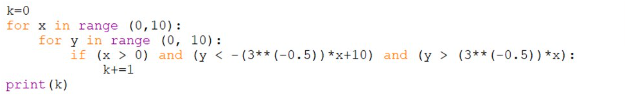

**Ответ:** 38

Можно ли сделать по-другому? Сейчас мы покажем вам **ещё один способ**:

1. Попросим черепашку поползать и оставить след. Пока просто для того, чтобы понять, что это за фигура.

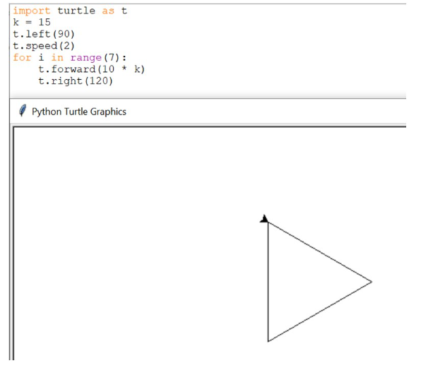

2. Опять будем анализировать вручную. Если мы не сообразили, что это за треугольник, то можно попросить черепашку его построить. Так как  шаги маленькие, делаем шаг 15, чтобы наш треугольник был побольше.  Поворачиваем черепаху на 90°, даем ей маленькую скорость, чтобы успевать отслеживать. И повторяем алгоритм 7 раз.
3. После этого можно включать аналитическую составляющую.Что делать, если мы не умеем составлять уравнения прямой? Тогда есть еще один  способ. Мы можем попросить черепашку не только нарисовать траекторию, а  еще и поставить точки в целочисленных координатах. Вот смотрите:

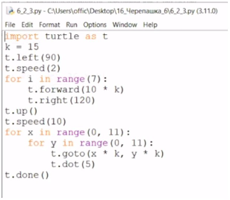

4. Мы поднимаем перо (t.up ()), поднимаем черепашку. Немножко увеличиваем скорость. Перебираем все **x** и y в каком-то разумном интервале и точечное вставание на точку с  заданными координатами (t.goto). То есть черепашка прыгает в эти узлы  координатной сетки и рисует точку диаметром 5 (t.dot). Смотрите, что  получается:

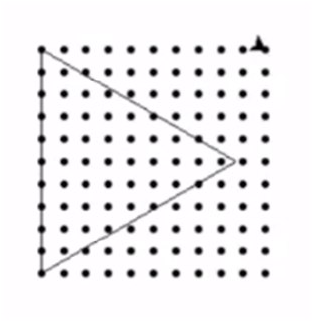

5. Сначала черепаха рисует треугольник, как раньше, а потом ходит и  ставит точки. Фигура небольшая, и мы можем посчитать эти точки  внутри.Что делать, если мы не уверены, входит точка в область или нет?  Можно увеличить треугольник, нарисовать его крупнее, сделав не 15, а 30. Теперь хорошо видно и можно посчитать количество точек.

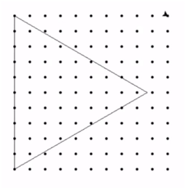

**Ответ:** 38

На этот раз мы все сделали вручную. И даже посчитали точки.Есть ли  способ продолжить развитие этой программы и попросить черепаху еще и  посчитать точки? Есть. Но мы намеренно не будем даже пытаться вам это  дать.Это задача № 6. Нет уверенности, что надо черепаху программировать. Но можно  воспользоваться раскраской, по-разному раскрасив внутреннюю и внешнюю  области и посчитать точки конкретного цвета. Можно воспользоваться  рисованием другого слоя сетки и так далее, но это уже усложнение  программы. В случае, если нам предстоит решать какие-то сложные задачи  со сложными траекториями, то да, можно поручить черепахе посчитать. Но у нас такая задача не стоит. Нам надо для конкретной черепахи посчитать  конкретную траекторию.

 

**Разберём ещё одно задание:**

*Черепахе был дан для исполнения следующий алгоритм: **Повтори 4 [ Вперёд 7 Направо 90 Вперёд 7 Налево 90 Вперёд 7 Направо 90 ]** Определите, сколько точек с целочисленными координатами будут  находиться внутри области, ограниченной линией, заданной данным  алгоритмом. Точки на линии учитывать не следует.*

**Решим аналитически:**

1. В условии сказано: «Повторить 4 раза: вперед 7,направо 90. Вперед  7, налево 90. Еще раз вперед 7 и направо 90».1 виток: вперед 7 направо  90 вперед 7 налево 90 вперед 7 направо 90.

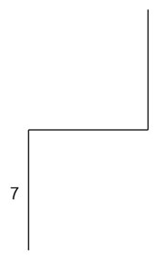

2 виток: вперед 7 направо 90 вперед 7 налево 90 вперед 7 направо 90.

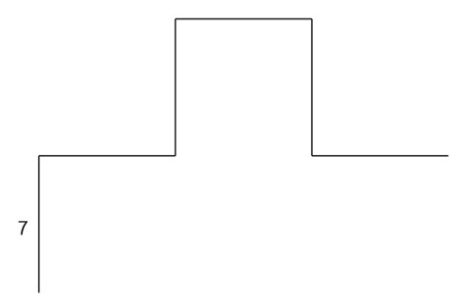

3 виток: вперед 7 направо 90 вперед 7 налево 90 вперед 7 направо 90.

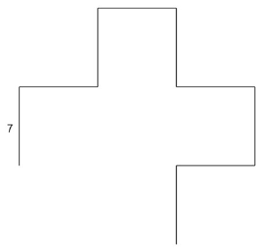

4 виток: вперед 7 направо 90 вперед 7 налево 90 вперед 7 направо 90.

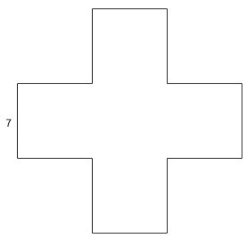

2. Вот такой крестик нарисовала черепаха. Нарисуем ось x и ось y.

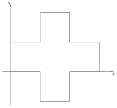

3. Для начала можно искомые точки посчитать вручную. Только надо, чтобы точки не попали на границу.

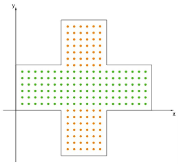

4. Точек в высоту будет 6, а в ширину 7 + 7 + 6 = 20. Это область закрашена зеленым.

И еще две верхушки (оранжевый цвет). Два раза 7 в высоту и 6 в  ширину.В итоге количество точек будет 6 * (7 + 7 + 6) + 2 * 7 * 6 = 204

**Ответ:** 204

 

**Решим задачу по-другому, задав условия формулами:**

**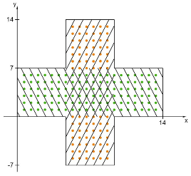
**

1. Сначала зададим программу, которая нарисует этот крестик.

**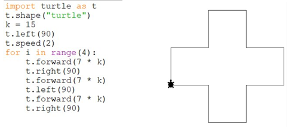**

2. Теперь анализируем: 0 < y < 7 или 7 < x < 14.

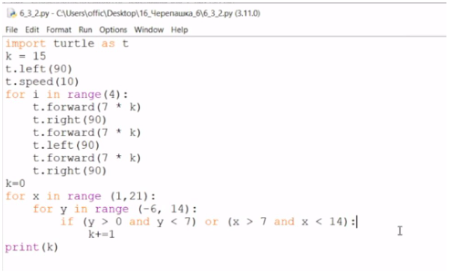

3. Программа нарисовала фигуру и посчитала точки (204).Такой способ  лучше, потому что мы создаем условия для прямых и не занимаемся  подсчетом вручную. Но можем и посчитать вручную.

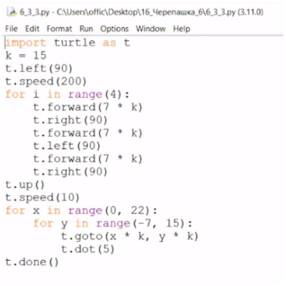

Черепаха не только рисует фигуру, но и ставит точки.

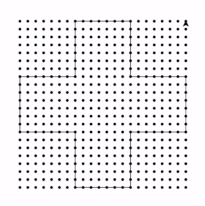

**Ответ:** 204

**Посмотрим, как решается ещё один подобный пример:**

*Черепахе был дан для исполнения следующий алгоритм: **Повтори 9 [ Вперёд 30 Направо 90 Вперёд 40 Направо 90 ]** Определите расстояние между положениями Черепахи в начале и в конце выполнения этой программы.*

**Решим аналитически, написав небольшую программу:**

1. Нарисуем движение черепахи:

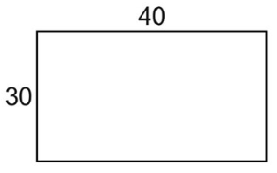

2. Черепаха ходит по сторонам прямоугольника. Где же она остановится? Один виток цикла – это черепаха марширует по 2м сторонам, 9 раз.Если  черепаха начала движение в точке А, то завершит она движение в точке В.

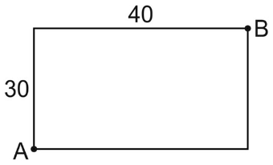

3. Теперь нужно найти расстояние, теорема Пифагора нам в помощь.

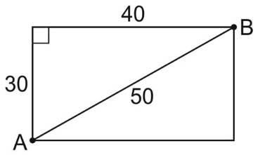

4. Искомое расстояние равно 50. Смысла программировать нет. Для тех,  кто не увидел сразу прямоугольник и хочет понять, что черепаха  нарисовала, давайте запрограммируем. Запускаем алгоритм на отрисовку.

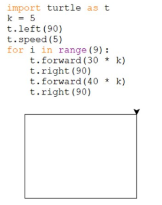

5. Сетку не рисуем, мы и так знаем, что стороны 30 на 40. Не усложняем.

**Ответ:** 50

**Приступим к разбору следующего прототипа задачи:**

*Черепахе был дан для исполнения следующий алгоритм: **Повтори 9 [ Вперёд 30 Направо 90 Вперёд 40 Направо 90 ]** Определите, сколько точек с целочисленными координатами будут  находиться внутри области, ограниченной линией, заданной данным  алгоритмом. Точки на линии учитывать не следует.*

**Решение:**

1. Задача такая же, но теперь нам нужно посчитать точки, которые  внутри.Рисунок тот же самый. Нам нужно понять, сколько точек с  целочисленными координатами оказалось внутри рисунка.Строго внутри будет 29 точек вверх и по горизонтали 39. Умножаем и считаем: 29 * 39 = 1131

Если хотим попросить об этом черепаху, то давайте это сделаем:

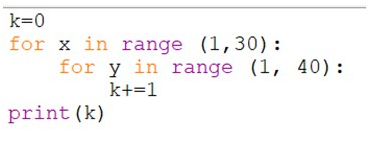

Получили 1131.

2. Можно попросить черепашку порисовать точечки:

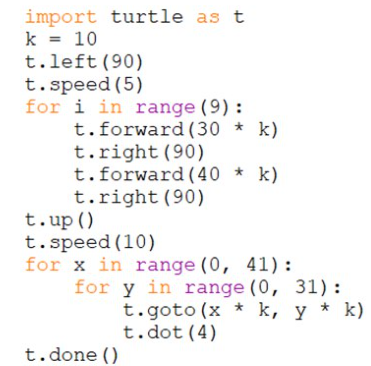

**Ответ:** 1131

**Рассмотрим ещё одну задачу в рамках этой темы:**

*Черепахе был дан для исполнения следующий алгоритм: **Повтори 5 [ Вперёд 7 Направо 45 Вперёд 7 Направо 135 ]** Определите, сколько точек с целочисленными координатами будут  находиться внутри области, ограниченной линией, заданной данным  алгоритмом. Точки на линии учитывать не следует.*

**Решение:**

1. Сделаем рисунок движения черепахи:

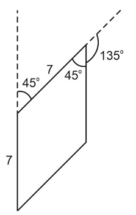

2. Добавляем ось x и ось y:

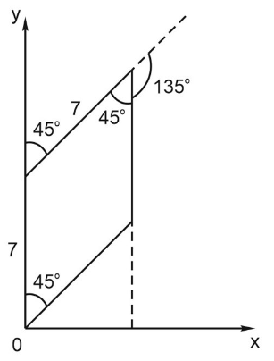

3. Вручную посчитать сложно. Давайте попросим черепаху помочь:

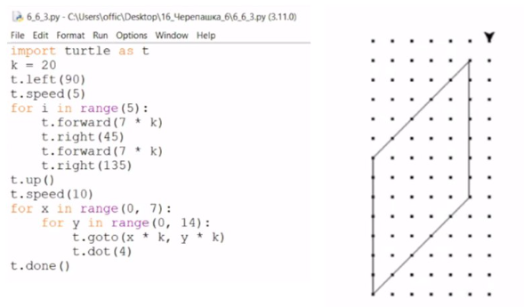

4. Фигура маленькая, можно увидеть, что точек 4 * 6 = 24. А можно сделать и по-другому. Опишем системой уравнений:

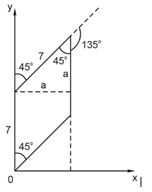

$a^2+a^2=7^2$, значит, $a=\frac{7}{\sqrt2}$.

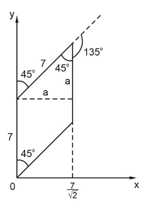

5. Уравнение первой прямой y = x

Уравнение другой прямой y = x + 7

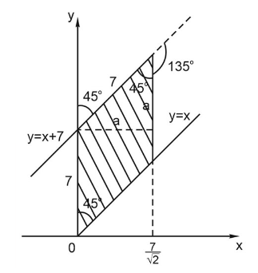

6. Запрограммируем:

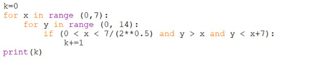

Получим результат 24.

**Ответ:** 24

Это программный метод, и он имеет свои преимущества: вместо того  чтобы рисовать вручную, мы просто задаём уравнение и выполняем расчёт.  Важно уметь работать разными способами. Если форма фигуры сразу  очевидна, то нет необходимости её рисовать. Если возникают сомнения —  лучше сделать рисунок.
Когда у вас есть чертёж и понятно, как задать  систему неравенств, сразу переходите к этому этапу. Если что-то остаётся неясным, используйте программную отрисовку точек. Нам важны все методы — главное, чтобы результат был правильным.

**Перейдём к следующему примеру для закрепления материала:**

*Черепахе был дан для исполнения следующий алгоритм: **Повтори 8 [ Вперёд 9 Направо 60 Вперёд 9 Направо 120 ]** Определите, сколько точек с целочисленными координатами будут  находиться внутри области, ограниченной линией, заданной данным  алгоритмом. Точки на линии учитывать не следует.*

**Решение:**$$a = 9\cdot \sin 60^{\circ} = 9\cdot\frac{\sqrt3}{2}$$
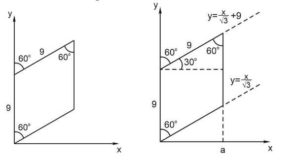

2. Напишем систему неравенств:

$$0\le y \le 9\frac{\sqrt3}{2}$$

$$y \ge \frac{x}{\sqrt3}$$

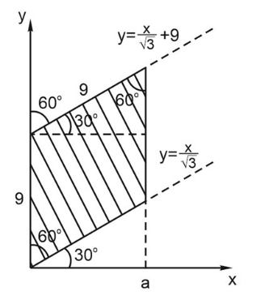

3. Запрограммируем и нарисуем точки:

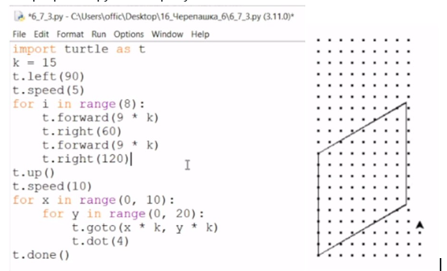

4. А можно задать уравнения:

**Ответ:** 63

Нужно понимать, что задача №6 ЕГЭ по информатике с исполнителем «Черепашка» проверяет **базовые** навыки работы с алгоритмами и не требует глубоких теоретических знаний  или сложного программирования. Основная цель — дать верный ответ, следуя простым шагам и логике, не усложняя процесс.

**Важно** внимательно читать условие задачи и чётко  понимать, что от нас хотят составители: объединение или пересечение;  нужно ли считать точки на границах или нет.

Если есть сомнения в траектории, лучше нарисовать её на бумаге или  использовать программную визуализацию. Попробуйте решить задачу двумя  способами: аналитически (разобрав последовательность шагов и поворотов) и с помощью программирования (например, используя turtle в Python или  Черепаху в Кумире для наглядности). Это поможет убедиться в правильности ответа.

Выучите синтаксис Кумира и модуля turtle в python. Небольшой лайфхак: в Кумире есть подсказки по синтаксису. В панели навигации выбираем  исполнителя Черепаха и видим весь список наших команд.

Также помните, что задача требует умения чётко анализировать алгоритм и понимать, какие точки или фигуры образуются в результате движений  «Черепашки». Это поможет избежать ошибок и даст уверенность в  правильности решения.