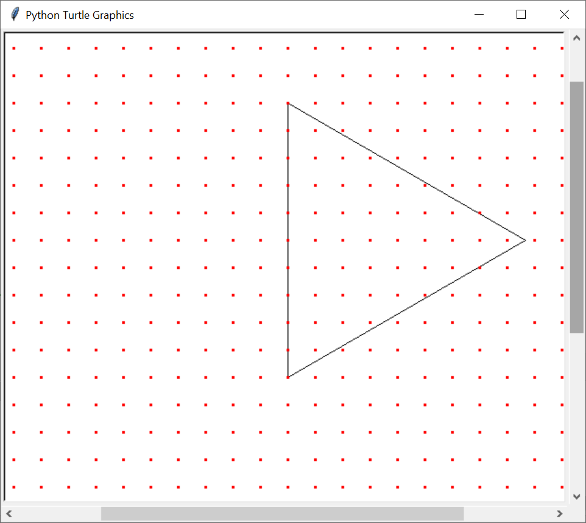

## Задание 6

Неплохая обзорная статья по нормальным методам решения: 

https://ege-study.ru/ru/ege/materialy/informatika/polnyi-kurs-podgotovki-k-ege-po-informatike/zadanie-6

Вариантов, грубо говоря, два: решать через Кумир или через Python.

Про Кумир можно немного почитать здесь:

https://docs.google.com/document/d/1fA_n1nLFpfFNEIC6zR1P_ZO2egzA5m7RhJTEr0j4PSg/edit#heading=h.fjx92hz3h63j

Про Python неплохо написано в статье на ege-study, но мы тоже приведём здесь свой пример кода.

### Пример (Python, счёт глазками)

Задача была что-то вроде посчитать количество целых точек внутри фигуры.

```python
from turtle import*
left(90)
m = 30 # масштаб
tracer(0) # рисовать моментально
screensize(900,900)


#------------  алгоритм 
down()
for _ in range(7):
    forward(10*m)
    right(120)


#---------------

up()
for x in range(-m,m):
    for y in range(-m,m):
        goto(x*m,y*m) # перемести в точку с коорд
        dot(4, 'red')


update() # обновить экран
done() # чтобы не закрывалось окно с черепахой
```

Результат работы программы:
