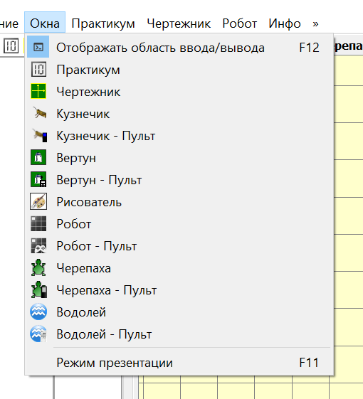
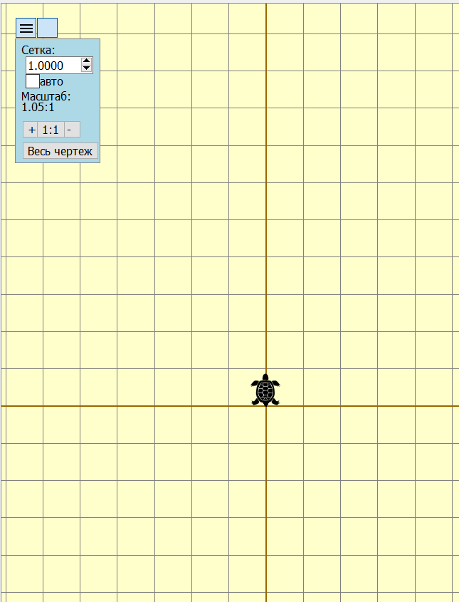
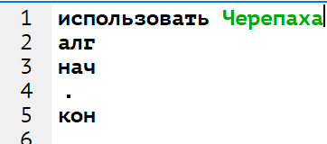
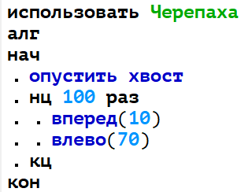
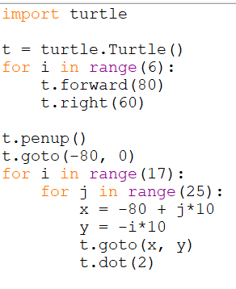

## Задание 6

Вариантов, грубо говоря, два: решать через Кумир или через Python.

## Решение через Python

```
Повтори 7 [Вперёд 12 Направо 90 Вперёд 20 Направо 90]
Поднять хвост
Вперёд 1 Направо 90 Вперёд 10 Налево 90
Опустить хвост
Повтори 7 [Вперёд 66 Направо 90 Вперёд 92 Направо 90]
```


| Русская команда                 | Python команда                                                     |     |
| ------------------------------- | ------------------------------------------------------------------ | --- |
| `Вперёд 12`                     | `forward(12*m)`                                                    |     |
| `Назад 12`                      | `backward(12*m)`                                                   |     |
| `Направо 90`                    | `right(90)`                                                        |     |
| `Налево 90`                     | `left(90)`                                                         |     |
| `Повтори 7 [кмнд1 кмнд2 кмнд3]` | `for _ in range(7):`<br>`    cmd1`<br>`    cmd2`<br>`    cmd3`<br> |     |
| `Опустить хвост`                | `pendown()`                                                        |     |
| `Поднять хвост`                 | `penup()`                                                          |     |
### Пример (Python, счёт глазками)

Задача была что-то вроде посчитать количество целых точек внутри фигуры.

```python
from turtle import*
left(90)
m = 30 # масштаб
tracer(0) # рисовать моментально
screensize(900,900)


#------------  алгоритм 
down()
for _ in range(7):
    forward(10*m)
    right(120)


#---------------

up()
for x in range(-m,m):
    for y in range(-m,m):
        goto(x*m,y*m) # перемести в точку с коорд
        dot(4, 'red')


update() # обновить экран
done() # чтобы не закрывалось окно с черепахой
```

Результат работы программы:


### Решаем на Кумир

Проще всего открыть среду “Кумир”, перепечатать туда программу, включить сетку и посчитать её узлы. В настройках сетки надо указать единичный масштаб.

Как открыть поле с Черепахой:



Настройка сетки:


Не забыть “использовать Черепаха” в начале:



Пример полного текста программы:



Для сравнения, аналогичная (неполная) программа на Python:



Минусы:

- не очень быстро
- надо не забывать масштабировать, потому что минимальное разрешение — 1 пиксель
