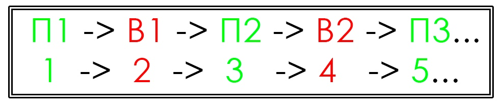
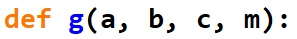
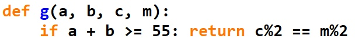
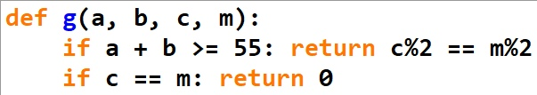
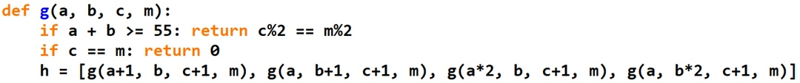
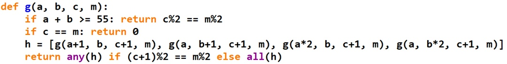
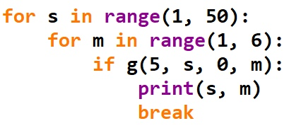
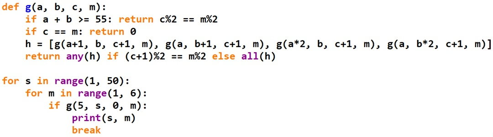
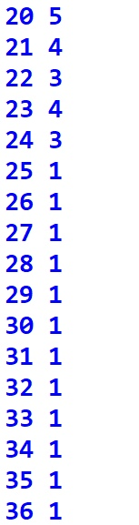

источник: https://vk.com/@inform_web-rekursivnyi-podhod-k-resheniu-tigra-2

# Рекурсивный подход к решению ТИГРа №2

В нашей [недавней статье](https://vk.com/@inform_web-rekursivnyi-podhod-k-resheniu-tigra) мы уже рассматривали, как можно решать задачки №19-21 на теорию игр с  помощью рекурсивного алгоритма на Python. Как обсуждалось, у того  способа есть свои минусы. В этой статье мы на примере задачи на 2 кучи  камней рассмотрим новый и интересный метод рекурсивного решения теории  игр, который был придуман весной 2022 года. Он интересен тем, что его  запись более компактна (по сравнению с предыдущим рассмотренным нами  способом), а кроме того, для его реализации не требуется кэширование - в нём описано условие выхода (обруба текущей рекурсивной ветки), которое  завершает алгоритм на том моменте, когда логически копать глубже уже не в наших интересах. 

### Решаем задачу на 2 кучи камней

*(№1227 kompege) «Два игрока, Петя и Ваня, играют в следующую игру. Перед  игроками лежат две кучи камней. Игроки ходят по очереди, первый ход  делает Петя. За один ход игрок может добавить в одну из куч (по своему  выбору) один камень или увеличить количество камней в куче в два раза.  Например, пусть в одной куче 7 камней, а в другой 5 камней; такую  позицию в игре будем обозначать (7, 5). Тогда за один ход можно получить любую из четырёх позиций: (8, 5), (14, 5), (7, 6), (7, 10). Для того  чтобы делать ходы, у каждого игрока есть неограниченное количество  камней. Игра завершается в тот момент, когда суммарное количество камней в кучах становится не менее 55. Победителем считается игрок, сделавший  последний ход, т.е. первым получивший такую позицию, что в кучах всего  будет 55 камней или больше. В начальный момент в первой куче было пять  камней, во второй куче — S камней; 1 < S < 49. Будем говорить, что игрок имеет выигрышную стратегию, если он может выиграть при любых  ходах противника. Описать стратегию игрока — значит описать, какой ход  он должен сделать в любой ситуации, которая ему может встретиться при  различной игре противника. В описание выигрышной стратегии не следует  включать ходы играющего по этой стратегии игрока, не являющиеся для него безусловно выигрышными, т.е. не являющиеся выигрышными независимо от  игры противника.
**Задание 19.
**Укажите минимальное значение S, при котором Петя может выиграть своим первым ходом.*

***Задание 20.
\****Для игры, описанной в задании 19, найдите два значения S, при которых у  Пети есть выигрышная стратегия, причём одновременно выполняются два  условия:— Петя не может выиграть за один ход;
— Петя может выиграть своим вторым ходом независимо от того, как будет ходить Ваня.
Найденные значения запишите в ответе в порядке возрастания.*

***Задание 21.
\****Для игры, описанной в задании 19, найдите минимальное значение S, при котором одновременно выполняются два условия:
— у Вани есть выигрышная стратегия, позволяющая ему выиграть своим первым или вторым ходом при любой игре Пети;
— у Вани нет стратегии, которая позволит ему гарантированно выиграть своим первым ходом.»*

Для решения задачи мы условимся определять результат игры исходя из  чётности номера последнего сделанного хода. Для этого нужно понять,  какие номера соответствуют различным ходам игроков. Если первый ход  обозначить за №1, тогда 1 будет обозначать, что Петя побеждает своим  первым ходом. Тогда первый ход Вани = №2 => 2 значит, что Ваня  побеждает своим вторым ходом, и т.д.:

    

Из этого суждения можно  заметить, что чётность номеров позиций, в которых побеждают разные  игроки, различается. Если побеждает Петя, то это всегда происходит за  нечётное количество ходов, если Ваня - наоборот, всегда только за  чётное. Это легко объясняется их чередованием, и этот факт мы будем  использовать для дальнейшей реализации рекурсивного алгоритма.

Весь код мы разделим на две части, где в первой разберем, непосредственно,  саму функцию, а во второй - способ прогонки через неё различных  аргументов и вывод результатов.

1. Опишем основную игровую функцию. На вход она будет принимать 3, 4 или 5  параметров (в зависимости от количества куч, которые есть в игре - 1, 2  или 3), в нашем случае ровно 4: первый параметр - количество камней в  первой куче, второй параметр - количество камней во второй куче, третий  параметр - количество ходов, которое сделано на текущий момент игры (на  момент вызова функции; как раз здесь нам и пригодится нумерация и  чётность) и четвёртый параметр - количество ходов, за которое нам нужно  выиграть (например, нам нужно выиграть за 3 хода - т.е., мы хотим, чтобы Петя победил своим вторым ходом, значит, передаем в качестве этого  параметра значение = 3):

    

Если количество камней в кучах ≥ 55, значит, игра завершается, и кто-то  победил. А кто? Ответить на этот вопрос поможет чётность количества  сделанных ходов, то есть параметр «c». Если он чётен, значит, победил  Ваня (ибо сделано чётное количество ходов), а иначе победил Петя. Когда  мы вызывали функцию, мы хотели победить за m ходов (а от чётности этого  значения зависело имя игрока, победа которого нас интересует), а это  значит, что если чётность c совпадает с чётностью m, то есть c%2 = m%2,  тогда всё хорошо - победил интересующий нас игрок. В противном же случае победил его соперник. Потому, если чётность совпала, мы вернем 1 -  истину (игра завершилась для нас удачно для данной позиции), а иначе  вернём 0 - ложь (интересующий нас игрок не смог победить за m ходов из  текущей позиции - неудача):

    

При этом, если мы хотим победить за m ходов, но, сделав c = m ходов, ещё не дошли до окончания игры (до значения суммы количества камней в кучах ≥  55), значит, игра затянулась. Смысла продолжать дальше нет, потому что  она завершится минимум за m + 1 ходов, что для нас уже неинтересно. Этим мы зададим условие обруба рекурсивной ветки - копаем вглубь лишь  настолько, насколько нам это нужно:

    

Теперь опишем ходы, которые можно сделать из текущей позиции (a, b). Ходы  будут представлять собой вызовы функции уже от новых значений, которые  будут возвращать 1 из двух результатов - истину или ложь, соответственно (имеется ли победа для текущего хода или нет). Мы запишем их в список.  При этом, когда мы меняем количество камней в кучах, мы делаем ход,  следовательно, меняется и параметр c, отвечающий за количество уже  сделанных ходов. Поскольку мы сделали еще один ход только что, c  увеличивается на 1:

    

Продолжая игру, мы смотрим, кто сейчас ходит. Если ходит нужный нам игрок, то  есть выражение (c+1)%2 = m%2 истинно (сейчас делается ход, и после него  количество сделанных ходов по чётности совпадает с тем количеством  ходов, за которое мы хотим выиграть), значит, нам достаточно того, чтобы он выиграл хотя бы одним ходом, то есть, чтобы хотя бы один ход из  переданных в h дал истинный результат игры - победу. Но в том же случае, если чётность не совпала (то есть, сейчас ходит враг), нам нужно, чтобы он НЕ выиграл ни при каком из ходов, а иначе говоря, чтобы наш игрок  выиграл в результате при всех возможных ходах врага. То есть, все до  единого ходы в списке h должны вести к истинному результату игры. Опишем мы это с помощью конструкций all / any (any - хотя бы что-то истинно из итерируемой последовательности; all - все истинно):

    

1. Основная функция описана, теперь можно с ней работать. Мы будем перебирать  различные значения S, для каждого из которых рассматривать результат  игры при различного количества ходов = m. И если вдруг для какого-то  значения S мы выиграем за m ходов, тогда мы будем обрубать второй цикл  перебора m с помощью break, поскольку нас интересует самая быстрая  (основная) игра. Дело в том, что чётность, допустим, значения 3,  совпадает с чётностью значения 5. Потому, если функцию запустить от  тройки и от пятерки, мы в обеих ситуациях получим истину (в момент  победы чётность совпадет). Но важная тонкость заключается в том, что до  5-ки мы попросту не дойдем - мы сразу же выиграем за 3 хода. Но, если мы не выиграем 3-м ходом, то враг 100% выиграет своим 4-м, ведь мы ещё  больше приблизимся к победе. Потому, чтобы не получать на выводе ложные  значения, мы будем обрубать перебор m, находя самое маленькое количество ходов, за которое кто-то может выиграть из текущей позиции. Выводим  значение S и m, по S определим количество камней в интересующей нас  куче, а по m - кто и каким ходом выиграл:

    

Значение m мы перебирали до 5 включительно (т.е., до П3). Можно копать и глубже, если это необходимо. Получаем в итоге следующий код:

    

Запускаем его, а на выводе получаем следующую картину:

    

П3 = 5 = 20; В2 = 4 = 21 и 23; П2 = 3 = 22 и 24; П1 = 1 = 25 и все, что больше.
Получается, Петя побеждает своим первым ходом при минимальном значении S = 25.  Вторым ходом он побеждает при значениях S = 22, S = 24. А Ваня  гарантированно побеждает своим первым или вторым ходом при значениях S = 21, S = 23, минимальное же из них = 21.

**Ответ: 19) 25; 20) 22, 24; 21) 21.**

Довольно компактный рекурсивный алгоритм, описанный выше, позволяет решать самые различные задачи. Преимущества его заключаются в короткой записи,  отсутствии нужды использовать кэширование и меньшем риске возникновения  ошибок. Кроме того, его довольно просто переписать и на другие языки  программирования - С++, PascalABC.NET, поскольку функции all и any можно развернуть с помощью and и or.