# Задание 22

## В чём суть

Дана таблица процессов. У каждого процесса есть свой номер (ID), есть длительность (в мс) и номера процессов, от которых они зависят. Есть также независимые процессы, которые обозначаются цифрой 0. Процесс может начаться, только если закончились все процессы, от которых он зависит. При этом независимые могут стартовать сразу же.

Вопрос (стереотипный): за какое минимальное время все эти процессы могут завершиться?

Вопрос (характера 2026 года): какое максимальное количество процессов может быть запущено одновременно? или: какое наибольшее количество времени могут быть запущены, скажем, 4 процесса одновременно?
## Пример

kompege-21906 (досрок 2026 года)

Пример файла:

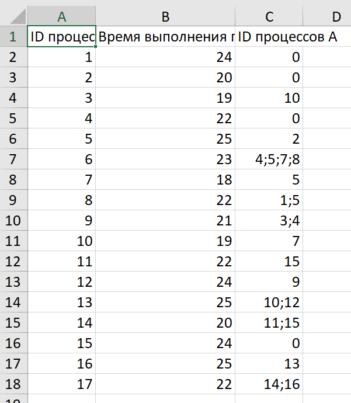

Для наглядности можно представить эту таблицу как граф (не вз):


Кружочками обведены независимые процессы.

Подготовка таблицы к рисованию диаграмм Ганта:


Применим к столбцу C операцию разделения данных по столбцам:

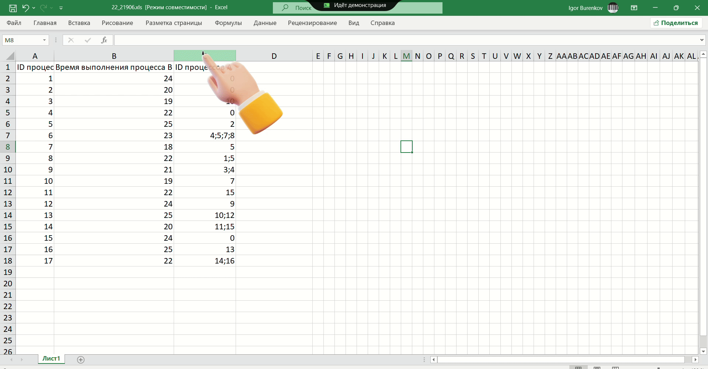

По шагам:
1. Выделить столбец с зависимостями процессов

2. Зайти в меню "Данные":

3. Найти раздел "Работа с данными" и кнопку "Текст по столбцам", нажать на неё

4. В открывшемся окне оставляем формат данных "с разделителями" по умолчанию, нажимаем "Далее"

5. На следующем экране ищем список разделителей

6. Отмечаем "точка с запятой" ("знак табуляции" можно не трогать, он нам не мешает), после чего нажимаем "Готово"

7. Собственно, готово:


Те ячейки, которые содержали в себе перечисление нескольких процессов-зависимостей через символ точки с запятой, теперь распределились по соседним столбцам справа. В данном случае всего четыре столбца получается (по максимальному числу процессов-зависимостей).

Заводим фейковый нулевой процесс:

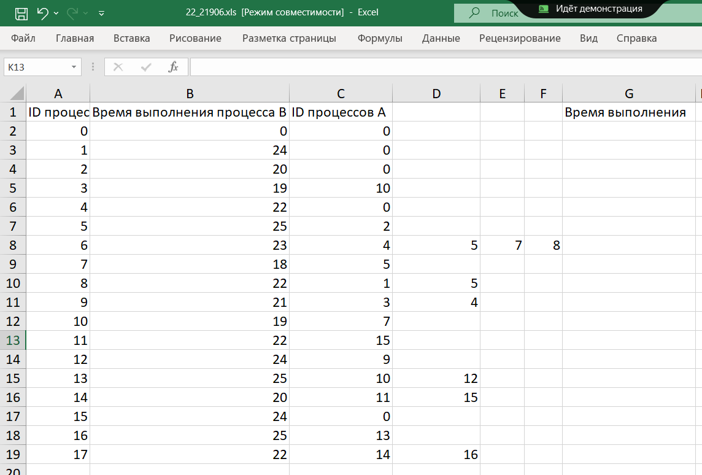

Бахнем четыре дополнительных столбца (столько, сколько получилось столбцов после разделения столбца C по столбцам):

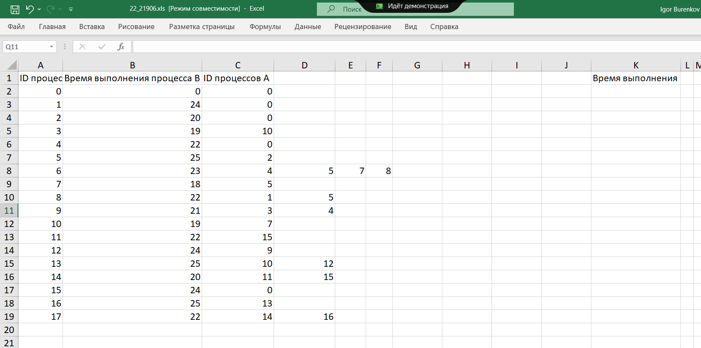

Проплатим: 

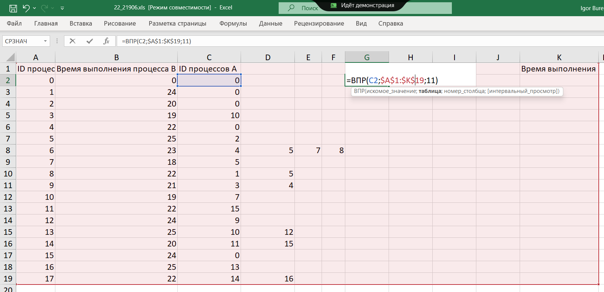

Формула:

```excel
=ЕСЛИОШИБКА(ВПР(C2;$A$2:$I$26;9);0)
```

Заполним также столбец "Время выполнения":

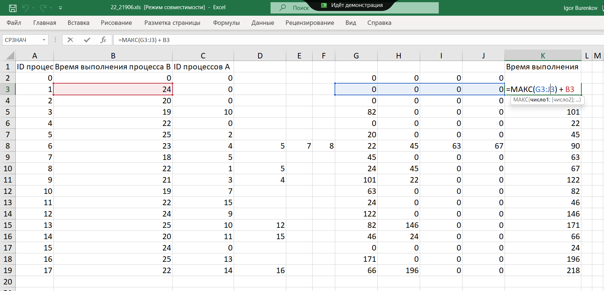

Формула:

```excel
=МАКС(F2:H2)+B2
```

## Решение через Python

Сохранить как текстовый файл с разделителями — табуляциями.

```python
# kompege-29352

A = [s.split() for s in open("22_29352.txt")]

for s in A[1:]:
    s[1] = int(s[1])
    if '"' in s[2]:
        s[2] = [int(x) for x in s[2].replace('"', '').split(";")]
    else:
        s[2] = [int(s[2])]

def f(n):
    if A[n][2] == [0]:
        return A[n][1]
    return max(f(x) for x in A[n][2]) + A[n][1]

print(max(f(i) for i in range(1, len(A))))
```

Максимальная длительность пяти процессов одновременно

```python
# kompege-27775
from dataclasses import dataclass
from itertools import product

@dataclass
class Process:
    duration: int
    deps: list[int]

A = [s.split() for s in open("22_27775.txt")]

proc = {}
for s in A[1:]:
    proc[int(s[0])] = Process(
        duration = int(s[1]),
        deps = [int(x) for x in s[2].replace('"', '').split(";")]
    )

def f(n):
    if proc[n].deps == [0]:
        return proc[n].duration + displacement[n]
    return max(f(x) for x in proc[n].deps) + proc[n].duration

L = []
for d in product(range(30), repeat = 3):
    displacement = dict(zip(
        [101, 102, 109, 110],
        [0] + list(d)
    ))
    
    T = {}
    for i, p in proc.items():
        finish = f(i)
        start = finish - p.duration
        T[start] = T.get(start, 0) + 1
        T[finish] = T.get(finish, 0) - 1

    times = sorted(T.keys())

    n = 0
    start = None

    for t in times:
        old = n
        n += T[t]
        if old != 5 and n == 5:
            start = t
        
        if old == 5 and n != 5:
            L.append(t - start)


print(max(L))
```

## См. также

https://itchief.ru/python/ege-22

## Архив

### Ручное построение диаграммы Ганта

Пример файла:


Подготовка таблицы к рисованию диаграмм Ганта:


Рисуем диаграмму для процесса (количество единиц совпадает с длительностью процесса)

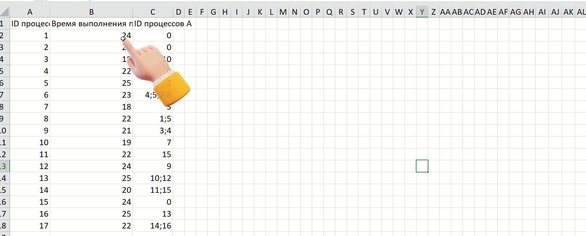

Вот что должно получиться после проставления длительностей независимых процессов:

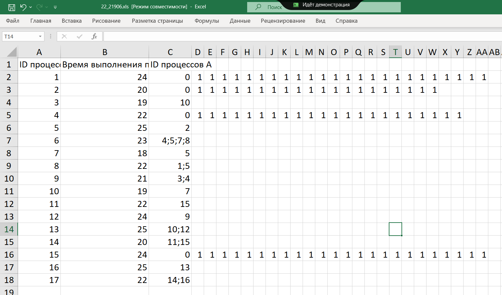

Видим, что этим способом эта задача решается очень неудобно:

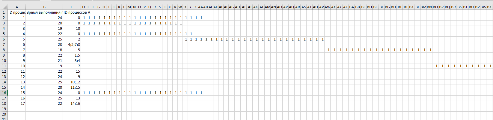

### Ручное вычисление минимального времени выполнения всех процессов

Проставляем время завершения для независимых процессов:

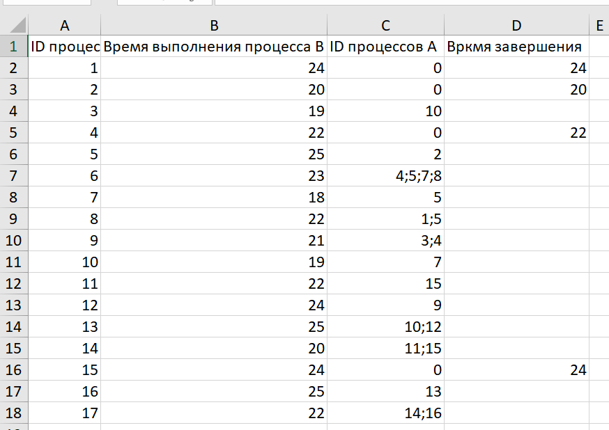

Далее заполняем таблице по следующему принципу: берём какой-нибудь зависимый процесс. Если время окончания процесса, от которого наш процесс зависит, известно, то мы к нему просто прибавляем время выполнения текущего процесса и проставляем в колонку "время выполнения". Если процесс зависит от нескольких других процессов, то среди них мы выбираем тот, у которого время выполнения максимально. Наконец, если мы пока не знаем время выполнения процессов, от которых мы зависим, то мы переходим к строчке с этим процессом и пытаемся применить тот же алгоритм — при необходимости, спускаемся так несколько раз, до тех пор, пока текущий процесс не станет зависеть от известного/независимого.

Результат ручного счёта:

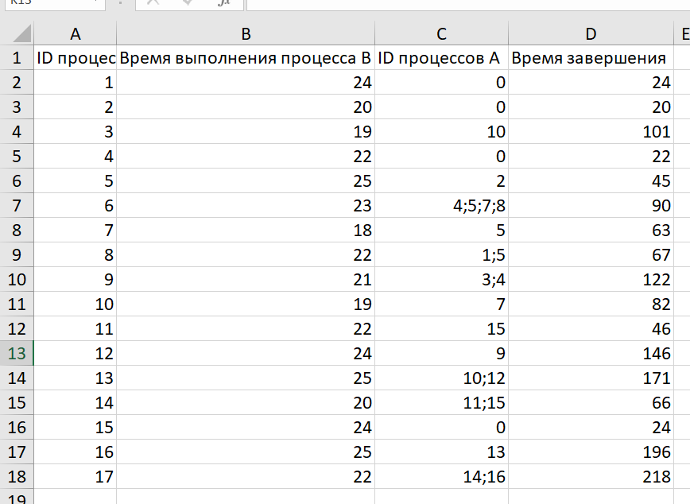

### Вычисление минимального времени выполнения всех процессов при помощи формулы ВПР с фейковым нулевым процессом

Заводим фейковый нулевой процесс:


Бахнем четыре дополнительных столбца (столько, сколько получилось столбцов после разделения столбца C по столбцам):


Проплатим: 


Заполним также столбец "Время выполнения":


