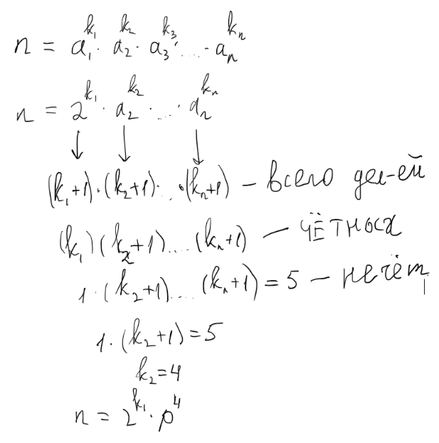

## Перебор с маской
Есть прекрасный модуль `fnmatch`, который позволяет с лёгкостью писать программы к номерам на маски над числами.

[Пример](https://inf-ege.sdamgia.ru/problem?id=60267)
> Среди натуральных чисел, не превышающих $10^10$, найдите все числа, соответствующие маске 1?2157*4, делящиеся на 2024 без остатка. В ответе запишите в первом столбце таблицы все найденные числа в порядке возрастания, а во втором столбце  — соответствующие им результаты деления этих чисел на 2024.
```python
from fnmatch import fnmatch

for n in range(0, 10**10+1, 2024):
    if fnmatch(str(n), "1?2157*4"):
        print(n, n // 2024)
```

С помощью модуля `itertools` можно организовать **молниеносный** перебор, не сильно раздувая программу:

> Назовём маской числа последовательность цифр, в которой также могут встречаться следующие символы:
> - символ "?" означает ровно одну произвольную цифру;
> - символ "\*" означает любую последовательность цифр произвольной длины; в том числе "\*" может задавать и пустую последовательность. Например, маске 123\*4?5 соответствуют числа 123405 и 12300425.
> Среди натуральных чисел, не превышающих $10^8$, найдите все числа, соответствующие маске 32\*823 и не делящиеся на 123 без остатка. В ответе запишите в первом столбце таблицы все найденные числа в порядке возрастания, а во втором столбце - соответствующие им частные от деления на 123.
```python
from itertools import product

for n in range(4):
	for x in product("0123456789", repeat=n):
		s = ""
		for l in x:
			s += l
		num = "32" + s + "823"
		if int(num) % 123 != 0:
			print(num, num // 123)
```

## Перебор делителей

### Простейшая программа для определения простоты числа

```python
a = int(input("Введите число: "))
k = 0
for i in range(2, a // 2+1):
    if (a % i == 0):
        k = k+1
if (k == 0):
    print("Число простое")
else:
    print("Число не является простым")
```
Пределы, в которых мы ищем делители, просты для понимания: не может быть целочисленного делителя больше, чем половина от числа. Но можно сделать хитрее...

### Более сложный пример: поиск простых множителей, с эволюцией

(kompege, var-25194722)

```python
k = 0
for n in range(6_300_000, 10_000_000):
    x = n
    A = []
    d = 2
    while d * d <= n:
        while n % d == 0:
            A.append(d)
            n //= d
        d += 1
    if n > 1:
        A.append(n)
    if len(A) != 3:
        continue
    
    maxI = max(A)

    has34 = True
    for i in A:
        if not("3" in str(i) or "4" in str(i)):
            has34 = False
            break    
    
    if has34:
        print(x, maxI)
        k += 1
        
    if k == 5:
        break
```

```python
k = 0
for n in range(6_300_000, 10_000_000):

    x = n
    A = []
    for i in range(2, int(n**0.5) + 1):
        
        while x % i == 0:
            A.append(i)
            x //= i

    if x > 1:
        A.append(x)

    if len(A) != 3:
        continue
      
    if all("3" in str(i) or "4" in str(i) for i in A):
        print(n, max(A))
        k += 1
        
    if k == 5:
        break
```

С комментариями:

```python
k = 0   # счетчик для количества найденных чисел, удовлетворяющих условиям задачи
for n in range(6_300_000, 10_000_000):

    x = n   # оберегаем n от изменений, так как нам нужно его значение для вывода

    #=================================================#
    # Алгоритм разложения числа на простые множители  #
    #=================================================#
    A = []
    for i in range(2, int(n**0.5) + 1):
        while x % i == 0:
            A.append(i)
            x //= i
    if x > 1:   # цикл может прерваться раньше, чем x будет равен 1, если x - простое число
        A.append(x)
    #=================================================#

    # Проверяем, что в разложении ровно 3 простых множителя
    if len(A) != 3:
        continue
    
    # Проверяем, что все простые множители содержат цифру 3 или 4
    if all("3" in str(i) or "4" in str(i) for i in A):
        print(n, max(A))
        k += 1
        
    if k == 5:
        break
```

Если потребуется поиск всех делителей, а не только простых, то проще оставить один цикл до корня из верхнего предела, и не забывать каждый раз добавлять в множество делителей его пару.

Если есть условие вида “5 нечётных делителей”, то можно организовывать перебор до корня четвёртой степени из максимального нечётного делителя:

$$ n = a_1^{k_1}\cdot a_2^{k_2}\cdot a_3^{k_3}\cdot ... \cdot a_n^{k_n}$$

Если n — чётное:

$$ n = 2^{k_1}\cdot a_2^{k_2}\cdot a_3^{k_3}\cdot ... \cdot a_n^{k_n}$$

Всего делителей:

$$ (k_1+1)\cdot(k_2+1)\cdot(k_3+1)\cdot...\cdot(k_n+1) $$

Из них чётных:

$$ k_1\cdot(k_2+1)\cdot(k_3+1)\cdot...\cdot(k_n+1) $$

А нечётных:

$$ 1\cdot(k_2+1)\cdot(k_3+1)\cdot...\cdot(k_n+1) $$

И вот это выражение равно 5.

Выражение являет собой произведение натуральных чисел. 5 — простое число, у него разложение на множители единственно: $ 5\cdot 1 $

Единица в этом произведении соответствует выбору нулевой степени для любого простого числа, и этих единиц может быть сколько угодно — это просто означает, что простое число не входит в каноническое разложение $n$.

А единственный простой множитель 5 означает, что для некоторого $k_2$ выполняется равенство $ k_2 + 1 = 5$, т.е. $k_2=4$.

Это означает, что число имеет вид $ n = 2^{k_1}\cdot p^4 $, где $p$ — некое простое число.

Отсюда и алгоритм проверки на существование "5 нечётных делителей": произвольное число мы сначала делим, сколько можем, на 2 (избавляясь от вклада чётных делителей), затем извлекаем корень четвёртой степени из нечётной части числа, и, если после этого получилось натуральное число, проверяем его на простоту перебором до корня из ВОТ ЭТОГО числа.


